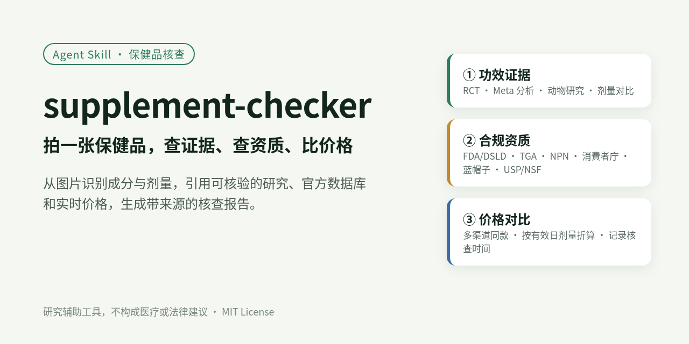
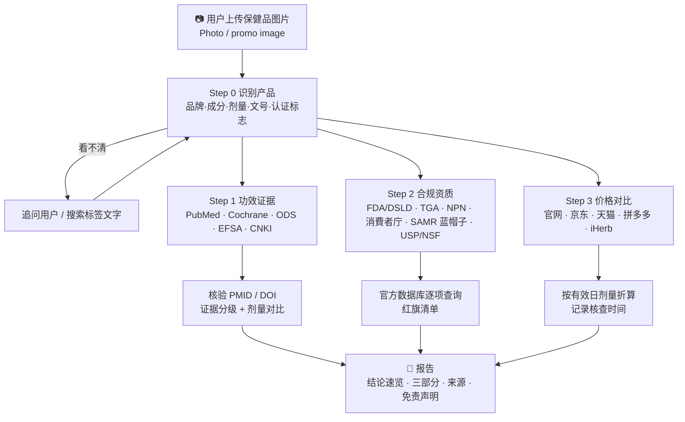
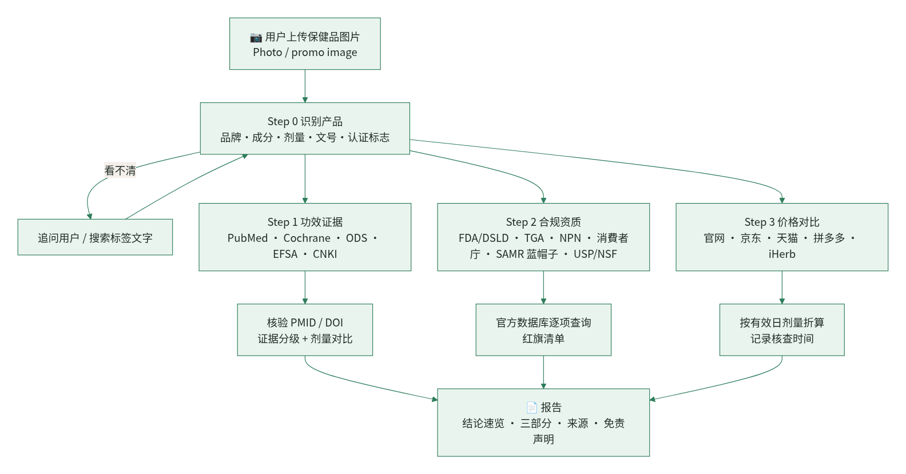
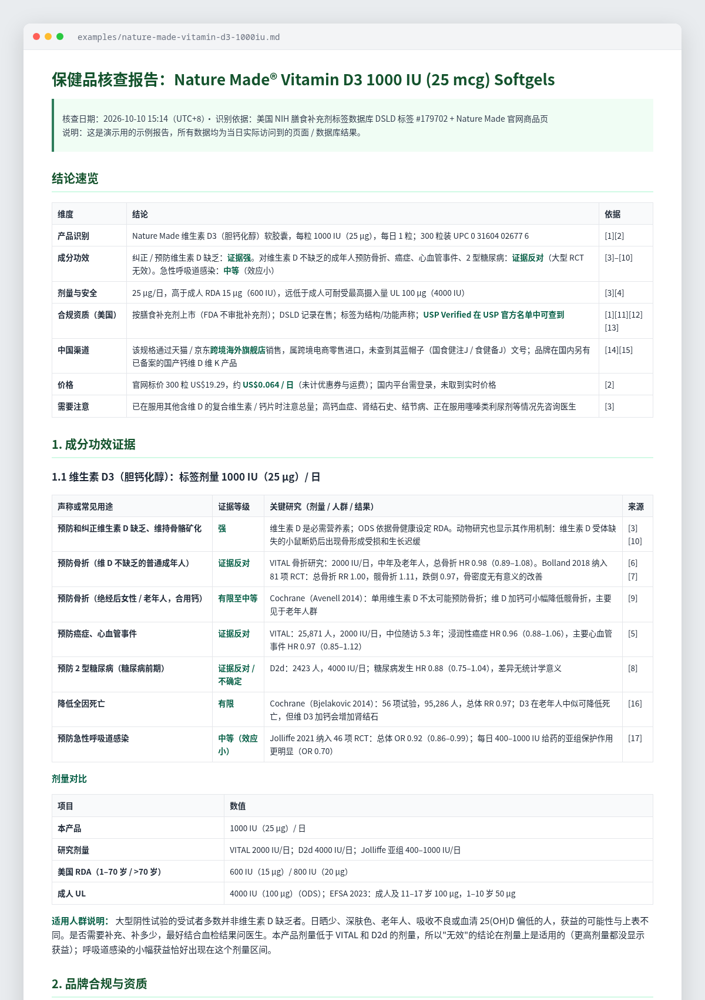

<p align="center"></p>

# supplement-checker · 保健品核查 Agent Skill

拍一张保健品的照片或宣传图，让 AI agent 按固定流程查三件事：

1. **成分功效证据**：动物研究、人体 RCT、Meta 分析，按证据等级分级，并和产品剂量对比
2. **品牌合规与资质**：美国 FDA/DSLD、澳洲 TGA、加拿大 NPN、日本消費者庁、欧盟/英国，以及中国蓝帽子 / 跨境渠道；第三方认证（USP、NSF、Informed Sport 等）到认证方数据库核实
3. **价格对比**：同款多渠道比价，同成分其他品牌按有效日剂量折算，并记录核查时间

最后输出一份每条结论都附来源链接的报告。

> ⚠️ **这是一个研究辅助工具，不是医疗建议，也不是法律意见。** 报告内容取决于检索时能访问到的数据库与网页，可能不完整或已过时。是否服用、服用多少，请咨询医生或药师。

## 工作流程



<p align="center"></p>

## 设计原则

- **不编造**：引用的每篇文献都要有 PMID / DOI / URL，并且在本次会话中实际访问核验过（PubMed E-utilities、Crossref）。
- **查不到就说查不到**：数据库打不开、需要登录或验证码时，标注"未能核验"并给出查询入口，不猜结果。
- **价格不估算**：每个价格都记录核查时间（含时区）；取不到实时价格时只给搜索链接。
- **结论与证据匹配**：按"结局 + 人群"分级，例如"纠正缺乏：证据强；不缺乏人群预防骨折：证据反对"。
- **区分事实与推断**："数据库未查到记录"不等于"违法"，报告会写明怎么查的。

## 示例报告

[`examples/nature-made-vitamin-d3-1000iu.md`](examples/nature-made-vitamin-d3-1000iu.md)：Nature Made 维生素 D3 1000 IU 软胶囊，核查于 2026-10-10（UTC+8）。

<p align="center"></p>

## 目录结构

```
supplement-checker/
├── SKILL.md                         # Skill 主文件（frontmatter: name + description）
├── references/
│   ├── regulators-by-region.md      # 各地区监管机构与官方查询入口（已逐个访问检查）
│   ├── evidence-grading.md          # 证据来源、核验方法、分级标准、剂量对比
│   ├── price-comparison.md          # 比价渠道、折算公式、真伪风险
│   └── report-template.md           # 报告模板 + 免责声明
├── examples/
│   └── nature-made-vitamin-d3-1000iu.md
├── docs/
│   ├── workflow.mmd                 # Mermaid 源文件
│   ├── skill-plain.txt              # SKILL.md 纯文本版（name + description + 正文）
│   ├── src/                         # 生成图片用的 HTML
│   └── images/                      # banner.png · workflow.png · example-report.png
├── LICENSE
└── README.md
```

## 安装

本仓库遵循通用的 Agent Skills 结构（一个文件夹 + `SKILL.md`），可放入支持 Skills 的 agent 的 skills 目录，例如：

- Claude Code：`~/.claude/skills/supplement-checker/` 或项目内 `.claude/skills/supplement-checker/`
- Cursor 等其他支持 `SKILL.md` 的工具：放入对应的 skills 目录

```bash
git clone https://github.com/masterball-w/supplement-checker.git
```

使用时上传保健品图片，并说"帮我查一下这个保健品"即可。agent 需要具备读图和联网检索 / 网页访问能力。

## 已知局限

- 部分官方数据库对自动访问不友好：中国特殊食品信息查询平台可能超时；Cochrane、Examine 会限流；FDA 食品设施注册数据库不公开。遇到这些情况报告会标注"未能核验"。
- 国内电商平台价格大多需要登录或 App，通常只能给出搜索链接。
- 各国法规会更新。`references/regulators-by-region.md` 的链接检查日期为 2026-10-10。
- 证据分级由 agent 按规则判断，不能替代专业的系统评价。

## 免责声明

本项目及其生成的报告仅供信息参考，不构成医疗、营养或法律建议。保健品不能替代药物治疗。孕期或哺乳期、儿童、慢性病患者、正在服药或计划手术者，使用任何补充剂前请咨询医生或药师。

---

## English

**supplement-checker** is an Agent Skill. Give it a photo or promo image of a dietary supplement, and the agent produces a sourced report on:

1. **Ingredient evidence**: animal studies, RCTs and meta-analyses, graded Strong / Moderate / Limited / Animal-only / Evidence against, with the product dose compared to study doses and to RDA/UL.
2. **Compliance and registrations**: US (FDA does not approve supplements; DSLD, NDI, warning letters, recalls), Australia (ARTG), Canada (NPN), Japan (FFC / FOSHU), EU/UK claim registers, China (cross-border vs general-trade 蓝帽子 registration/filing), plus third-party certifications verified in each certifier's own database.
3. **Price comparison**: the same product across channels, and the same ingredient across brands normalized per effective daily dose, with the time of each check recorded.

**Principles:**
- No fabricated citations; every PMID/DOI/URL is fetched and verified.
- Unreachable sources are marked "not verified" instead of guessed.
- No invented prices.

**This is a research aid, not medical or legal advice.** Results depend on what the agent could access at the time of the check.

Install by copying this folder into your agent's skills directory (e.g. `~/.claude/skills/supplement-checker/`). Licensed under MIT © 2026 masterball-w.
